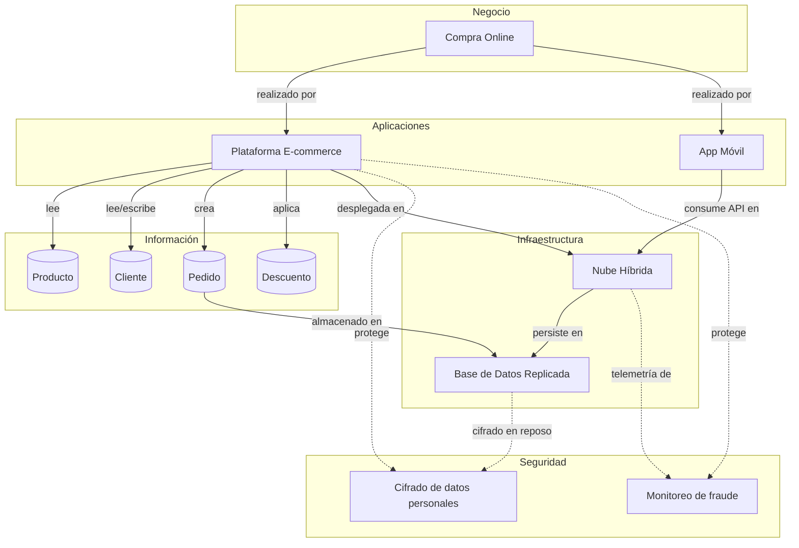
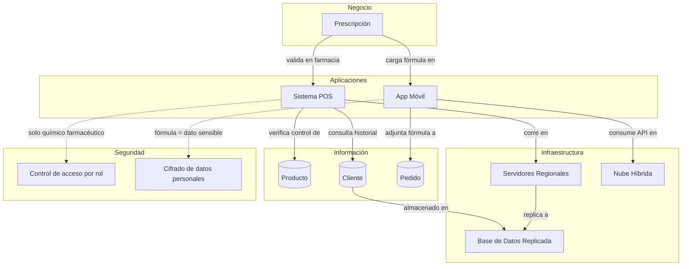
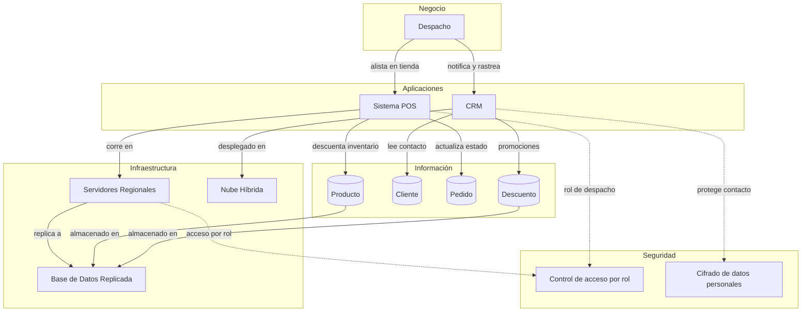

# Registro de Trabajo en Clase - Taller 8

## Fecha de la sesión
Sábado 24 de octubre de 2026.

## Integrantes presentes
- Alejandro Riveros (AlejandroRiveros)
- Juan Pablo Luna Zuleta (JhonlunKnox)
- Martín Ortega (m4rtin24)

## Actividades realizadas en clase

Se aplicó la metodología de 5 pasos de la [guía](guia_paso_a_paso_integracion.md) al caso base **FarmApp**. El tablero editable está en [`tablero-farmapp.drawio`](tablero-farmapp.drawio) y tiene una página por paso:

| Página del .drawio | Paso de la guía | Contenido |
|---|---|---|
| 1. Capas sueltas | Pasos 1 y 2 | Cinco capas (negocio, aplicaciones, información, infraestructura, seguridad) con sus 17 elementos, sin conectar |
| 2. Hilo Compra Online | Paso 3 | El hilo de la guía, ampliado con el enlace de la información y la infraestructura hacia seguridad |
| 3. Hilo Prescripción | Paso 3 | Segundo hilo, trazado con el mismo método |
| 4. Hilo Despacho | Paso 3 | Tercer hilo |
| 5. Tablero integrado | Paso 5 | Los tres hilos superpuestos; verificación sin huérfanos |

**Decisiones de modelado tomadas:**

1. **Un hilo a la vez.** Como recomienda la guía, primero se trazó Compra Online y después Prescripción y Despacho. Así cada página se puede leer sola y el tablero integrado no se satura.
2. **Cerrar el hueco que la guía deja abierto.** En el ejemplo de la guía, las entidades de información no se conectan con infraestructura. Aquí cada entidad se conecta con la *Base de Datos Replicada*, y cada elemento de infraestructura con un control de seguridad (la BD con el cifrado en reposo, la nube con el monitoreo de fraude y los servidores regionales con el control de acceso por rol).
3. **Seguridad como flecha distinta.** Las relaciones de protección van en rojo punteado, para que la seguridad se lea como decisión y no como anexo (error común 2 de la guía).
4. **Verbos en las flechas.** Cada conexión dice qué hace (“realizado por”, “lee”, “persiste en”, “protege”), alineado con las relaciones ArchiMate de la guía (serving, access, assignment).
5. **Prescripción usa el POS y el control por rol.** La validación de una fórmula médica la hace el químico farmacéutico en la farmacia, por eso el hilo pasa por el POS (en servidores regionales) y no solo por la nube. La fórmula se trata como dato sensible y se cifra.

**Herramientas:** draw.io (tablero), Mermaid (vistas rápidas dentro de este archivo, renderizadas por GitHub).

### Hilo Compra Online (Paso 3)

### Hilo Prescripción (Paso 3)

### Hilo Despacho (Paso 3)

### Narrativa de coherencia (Paso 4)

- **Compra Online.** Se apoya en la Plataforma E-commerce y la App Móvil, que comparten Producto, Cliente, Pedido y Descuento para que el inventario y los precios no diverjan entre canales. Ambas corren en la Nube Híbrida porque es la capa que absorbe los picos de campañas; la Base de Datos Replicada garantiza que el pedido no se pierda si una región falla. El cifrado y el monitoreo de fraude se aplican aquí porque es el único hilo con pago electrónico.
- **Prescripción.** El cliente carga la fórmula desde la App Móvil, pero la validación ocurre en el POS de la farmacia, donde el control de acceso por rol limita la aprobación al químico farmacéutico. El POS corre en los servidores regionales porque la farmacia debe poder validar aunque la conexión a la nube sea intermitente; la replicación sincroniza después. La fórmula es dato de salud, por eso se cifra desde la app.
- **Despacho.** El POS alista el pedido en la tienda más cercana y descuenta inventario; el CRM notifica al cliente y aplica promociones de recompra (Descuento). Que el CRM conozca el contacto del cliente obliga a cifrar ese dato, y que el POS cambie el estado del pedido obliga a que solo el rol de despacho pueda hacerlo.

### Verificación de huérfanos (Paso 5)

| Elemento | Capa | ¿Conectado hacia arriba? | ¿Conectado hacia abajo? |
|---|---|---|---|
| Compra Online | Negocio | — (capa más alta) | Plataforma E-commerce, App Móvil |
| Prescripción | Negocio | — (capa más alta) | App Móvil, Sistema POS |
| Despacho | Negocio | — (capa más alta) | Sistema POS, CRM |
| App Móvil | Aplicaciones | Compra Online, Prescripción | Nube Híbrida, Pedido, Cifrado de datos personales |
| Plataforma E-commerce | Aplicaciones | Compra Online | Producto, Cliente, Pedido, Descuento, Nube Híbrida, Cifrado de datos personales, Monitoreo de fraude |
| Sistema POS | Aplicaciones | Prescripción, Despacho | Producto, Cliente, Servidores Regionales, Control de acceso por rol, Pedido |
| CRM | Aplicaciones | Despacho | Cliente, Descuento, Nube Híbrida, Cifrado de datos personales |
| Producto | Información | Plataforma E-commerce, Sistema POS | Base de Datos Replicada |
| Cliente | Información | Plataforma E-commerce, Sistema POS, CRM | Base de Datos Replicada |
| Pedido | Información | Plataforma E-commerce, App Móvil, Sistema POS | Base de Datos Replicada |
| Descuento | Información | Plataforma E-commerce, CRM | Base de Datos Replicada |
| Servidores Regionales | Infraestructura | Sistema POS | Control de acceso por rol |
| Nube Híbrida | Infraestructura | Plataforma E-commerce, App Móvil, CRM | Monitoreo de fraude |
| Base de Datos Replicada | Infraestructura | Pedido, Cliente, Producto, Descuento | Cifrado de datos personales |
| Control de acceso por rol | Seguridad | Sistema POS, Servidores Regionales | — (capa más baja) |
| Cifrado de datos personales | Seguridad | Plataforma E-commerce, Base de Datos Replicada, App Móvil, CRM | — (capa más baja) |
| Monitoreo de fraude | Seguridad | Plataforma E-commerce, Nube Híbrida | — (capa más baja) |

Ningún elemento queda sin conexión hacia arriba y hacia abajo (salvo la capa más alta y la más baja, como indica la guía).

### Checklist de autoevaluación

- [x] Las 5 vistas están representadas como capas.
- [x] Se trazaron tres hilos completos de punta a punta (Compra Online, Prescripción, Despacho).
- [x] Ningún elemento queda huérfano (tabla anterior).
- [x] La narrativa explica el porqué de las conexiones.
- [x] Nombres consistentes con el README y la guía del taller.
- [ ] TO-BE marcado como NUEVO: no aplica al caso base; se aplica en la Parte 2 ([tablero del cliente](../entrega/tablero-integrado-cliente.drawio)).

## Boceto inicial del modelo

Ver [`tablero-farmapp.drawio`](tablero-farmapp.drawio) (abrir en [app.diagrams.net](https://app.diagrams.net/)). Los diagramas de cada hilo están arriba, en la sección de actividades.

## Tareas definidas para complementar el taller

| Tarea asignada | Responsable | Fecha estimada |
|----------------|-------------|----------------|
| Tablero integrado del cliente (draw.io) | Alejandro Riveros | 25/10 |
| Informe y reflexión crítica | Alejandro Riveros | 25/10 |
| Revisión del tablero frente a 03-C4 y 04-Infraestructura | Equipo | Por acordar |
| Revisión de controles frente a 05-STRIDE y 06-Normatividad | Equipo | Por acordar |
| Llevar a 03, 04 y 05 el cambio del Taller 7 (conciliación con Power Automate en vez de Power Query) | Equipo | Por acordar |

---

_Este documento resume el trabajo colaborativo realizado durante la sesión del taller 8 en el curso AREM - Universidad de La Sabana._
