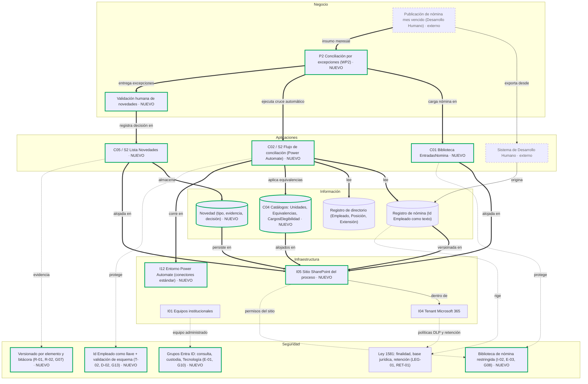
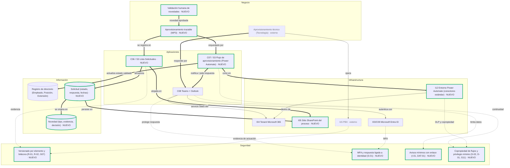
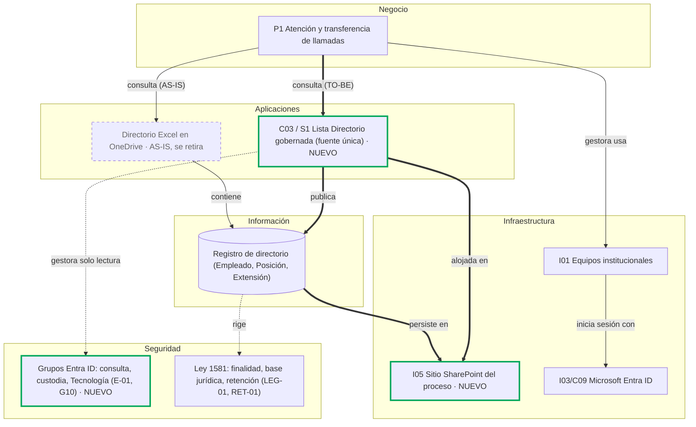

# Informe Técnico del Taller

## Nombre del Taller
_Taller 8 - Integración de Vistas de Arquitectura_

## Integrantes del equipo
- Juan Pablo Luna Zuleta (JhonlunKnox)
- Alejandro Riveros (AlejandroRiveros)
- Martín Ortega (m4rtin24)

**Cliente real:** Jefatura de Cultura de Innovación y Servicio, Universidad de La Sabana. **Problema:** el directorio de extensiones telefónicas que usan las gestoras para transferir llamadas se mantiene a mano y se desactualiza.

## Descripción general del trabajo

El taller integra en un solo tablero las vistas que el equipo construyó por separado durante el semestre: negocio (BPMN), información (modelo E-R), aplicaciones (C4), infraestructura (mapa y vista ArchiMate) y seguridad (STRIDE y checklist normativo). El tablero muestra el estado actual (AS-IS) y la arquitectura objetivo (TO-BE), y traza tres hilos de negocio de punta a punta por las cinco capas.

Entregables:

| Archivo | Contenido |
|---|---|
| [`tablero-integrado-cliente.drawio`](tablero-integrado-cliente.drawio) | Tablero editable, 5 páginas: capas sueltas, tres hilos y tablero integrado |
| `informe.md` (este documento) | Narrativa, decisiones, verificación de huérfanos y reflexión crítica |
| [`referencias.md`](referencias.md) | Fuentes del equipo y ejemplos reales de documentación de vistas |

## Proceso de desarrollo

**Insumos.** Se usaron los entregables consolidados del equipo en [AREM-Equipo3-Universidad-de-la-Sabana](https://github.com/JhonlunKnox/AREM-Equipo3-Universidad-de-la-Sabana): [`00-preliminary-vision`](https://github.com/JhonlunKnox/AREM-Equipo3-Universidad-de-la-Sabana/blob/main/00-preliminary-vision/vision.md), [`01-bpmn`](https://github.com/JhonlunKnox/AREM-Equipo3-Universidad-de-la-Sabana/blob/main/01-bpmn/informe.md), [`02-modelo-informacion`](https://github.com/JhonlunKnox/AREM-Equipo3-Universidad-de-la-Sabana/blob/main/02-modelo-informacion/informe.md), [`03-arquitectura-c4`](https://github.com/JhonlunKnox/AREM-Equipo3-Universidad-de-la-Sabana/blob/main/03-arquitectura-c4/informe.md) con su [esquema TO-BE](https://github.com/JhonlunKnox/AREM-Equipo3-Universidad-de-la-Sabana/blob/main/03-arquitectura-c4/esquema-datos-to-be.md), [`04-infraestructura`](https://github.com/JhonlunKnox/AREM-Equipo3-Universidad-de-la-Sabana/blob/main/04-infraestructura/informe.md), [`05-seguridad-stride`](https://github.com/JhonlunKnox/AREM-Equipo3-Universidad-de-la-Sabana/blob/main/05-seguridad-stride/informe.md) y [`06-normatividad`](https://github.com/JhonlunKnox/AREM-Equipo3-Universidad-de-la-Sabana/blob/main/06-normatividad/informe.md).

**Sobre el TO-BE del Taller 7.** El TO-BE marcado como NUEVO sale del Taller 7 del equipo ([AREM-Taller_7_Opportunities_Solutions](https://github.com/m4rtin24/AREM-Taller_7_Opportunities_Solutions): documento *Equipo3_Mejora_Arquitectura.pdf* y *matriz-brechas.xlsx*). De ahí se tomaron las tres soluciones priorizadas (S1 directorio gobernado, S2 conciliación automatizada, S3 aprovisionamiento trazable), sus paquetes de trabajo (WP1 a WP3) y las brechas G01 a G14 que cierran. El Taller 7 trabaja a nivel de solución; para el detalle (catálogos, biblioteca, sitio, entorno de flujos) se conservaron los IDs de 03 (C01 a C09) y 04 (I01 a I15), así que cada elemento del tablero muestra las dos referencias, por ejemplo “C02 / S2”.

**Pasos aplicados.**

1. **Capas.** Cinco franjas horizontales, de negocio (arriba) a seguridad (abajo), igual que en el caso FarmApp.
2. **Elementos.** Se transcribieron 34 elementos con el nombre e ID que tienen en su taller de origen (por ejemplo `C03`, `I05`, `T-02`). Los TO-BE llevan borde verde y la etiqueta **[NUEVO]**; los externos (Desarrollo Humano, PBX) y el Excel en OneDrive que se retira van en gris punteado.
3. **Relaciones.** Se trazaron tres hilos, uno por página, que corresponden a los dos procesos modelados en BPMN (P1 y P2) y a los requerimientos RQ1 a RQ3 de la visión. Cada flecha lleva un verbo; las nuevas van en verde y las de seguridad en rojo punteado con el ID de la amenaza o criterio que atienden.
4. **Narrativa.** Una por hilo, explicando qué decisión de qué taller produjo cada conexión.
5. **Consistencia.** Se generó la tabla de huérfanos a partir del mismo modelo que produce el .drawio, para que no puedan diferir. La primera versión dejó 8 huérfanos en infraestructura e información (por ejemplo, el tenant sin nadie arriba y los catálogos sin almacenamiento); se corrigieron antes de entregar.

**Herramientas.** draw.io para el tablero; Mermaid para las vistas que GitHub renderiza dentro de este informe.

## Análisis del modelo propuesto

### Cómo se estructura

El tablero tiene cinco páginas. La página 1 es el inventario por capas (Pasos 1 y 2). Las páginas 2 a 4 son los hilos (Paso 3). La página 5 superpone los tres hilos y es la vista que se usa para comprobar el Paso 5.

| Hilo | Solución T7 / paquete | Proceso BPMN | Brechas T7 | Bloqueos y fallas | Requerimientos |
|---|---|---|---|---|---|
| 1. Conciliación automatizada | S2 / WP2 | P2 (rediseñado) | G01, G05, G08, G11, G13, G14 | B1, B4, Q1, Q2, Q3 | RQ1, RQ4 |
| 2. Aprovisionamiento trazable | S3 / WP3 | P2 → Tecnología | G03, G04 | B2, B3 (el “estado absorbente”) | RQ2, RQ3 |
| 3. Directorio gobernado y atención | S1 / WP1 | P1 | G02, G06, G07, G09, G10, G12 | F1, F2 | G1 (directorio vigente) |

### Cómo representa las necesidades del cliente

La cliente pidió dos capacidades: detectar ingresos, retiros, cambios de cargo y vacancias con revisión humana de los casos ambiguos, y tener notificaciones en ambos sentidos con Tecnología. La primera es el hilo 1 y la segunda el hilo 2. El hilo 3 muestra por qué importan: es el único punto donde el problema llega al usuario final, y es donde el directorio TO-BE (C03) reemplaza al Excel en OneDrive.

También pidió quedarse dentro de la suite Microsoft. En el tablero eso se ve en la capa de infraestructura: todos los elementos nuevos caen dentro del tenant Microsoft 365, y los únicos sistemas fuera de él son los dos que ya existían y que el proyecto no toca (Sistema de Desarrollo Humano y PBX).

### Supuestos

- El TO-BE es el del Taller 7 (S1 a S3). Donde el Taller 7 y 03 difieren, manda el Taller 7 porque es posterior y decidió con matrices ponderadas (ver tensión 3 de la reflexión).
- `Id Empleado` se propaga al directorio y se conserva como texto (recomendación de 02 y contrato de 03). El tablero lo muestra en la entidad “Registro de nómina (Id Empleado como texto)”.
- Los controles de seguridad se dibujan como **propuestos**: en 05 y 06 la mayoría está “Por validar” o “Pendiente”, y el tablero no los presenta como implantados.
- No hay datos reales en el repositorio; los elementos son estructuras, no registros (Ley 1581, criterio REPO-01).

## Diagrama final entregado

Tablero editable: [`tablero-integrado-cliente.drawio`](tablero-integrado-cliente.drawio) (abrir en [app.diagrams.net](https://app.diagrams.net/)). Para leerlo sin draw.io, abajo están los tres hilos en Mermaid. Convenciones: `==>` conexión nueva (TO-BE), `-->` conexión existente, `-.->` control de seguridad; borde verde = NUEVO; borde punteado = externo o AS-IS que se retira.

### Hilo 1 — S2 Conciliación automatizada (WP2)

**Narrativa.** Desarrollo Humano sigue entregando la nómina mes vencido; eso no cambia porque es una restricción (C3) y no un defecto del proceso. Lo que cambia es lo que pasa después. La nómina deja de vivir en descargas sueltas y entra a una biblioteca propia (C01) en un sitio privado (I05), porque STRIDE identificó el acceso amplio al archivo completo como el riesgo más alto que sigue siendo Alto aun después de los controles (I-02). El cruce lo hace un flujo de Power Automate (C02 / S2), no una persona, porque el BPMN mostró que revisar 6.400 filas para hallar 5 a 10 novedades es la causa del retraso (B1, B4). El Taller 7 eligió el flujo sobre Power Query (4,80 frente a 4,00 en la matriz ponderada) porque genera solo las excepciones sin que alguien tenga que ejecutar el libro cada mes. Ese cruce solo funciona porque el modelo de información resolvió antes dos problemas: la llave (`Id Empleado` como texto, Q1 y Q2) y las dos taxonomías de unidad (catálogo de equivalencias C04, Q3). Por eso C02 lee tres cosas de la capa de información y no solo dos. El resultado son excepciones, no cambios aplicados: pasan por la validación humana y quedan como Novedad con su evidencia (C05), porque 03 decidió no actualizar el directorio a ciegas cuando una coincidencia es ambigua (control T-02). Como el flujo corre en el entorno de Power Automate del tenant (I12) y no en el equipo de una persona, toda la conciliación queda dentro de la frontera de confianza, que es lo que pedía G08.

### Hilo 2 — S3 Aprovisionamiento trazable (WP3)

**Narrativa.** Este hilo existe por un solo enlace que faltaba en el mapa de interacciones del BPMN: la confirmación de retorno desde Tecnología (B3). Sin ella, el estado “pendiente por aprovisionar” no tenía salida. La novedad aprobada se convierte en una Solicitud con estado propio (C06 / S3) y el flujo de aprovisionamiento (C07) la notifica por Teams/Outlook (C08) y recibe la respuesta, que es lo que reemplaza la reunión de 2 a 3 horas (B2). Es la alternativa B de la tercera matriz del Taller 7 (Lista + Power Automate + Teams, 4,60), elegida porque fue la única que obtuvo puntaje máximo en trazabilidad y cierre, el criterio eliminatorio. Las decisiones de seguridad aparecen justo donde está la conexión nueva: la respuesta de Tecnología debe venir de una identidad con MFA (S-01) y quedar registrada con usuario y fecha (R-01), porque es la que cambia el estado del directorio; y el aviso solo lleva un ID y un enlace, no la nómina (I-01, E-03). Tecnología sigue operando el PBX a mano. No se integró porque estaba fuera de alcance desde la visión, así que la única evidencia de que la extensión existe es la respuesta registrada en C06 (brecha G04: “confirmación humana registrada después de operar la PBX”). Los flujos corren con conectores estándar (I12) y con copropietarios (S-02, D-01) porque la restricción C2 descarta conectores premium y porque un flujo de una sola persona se detiene cuando esa persona se va (RT1).

### Hilo 3 — S1 Directorio gobernado y atención de llamadas (WP1)

**Narrativa.** La gestora no cambia su trabajo: contesta, busca y transfiere. Lo que cambia es de dónde lee. En AS-IS lee un Excel en OneDrive cuya titularidad no está confirmada (Q8, N3); en TO-BE lee la lista C03 / S1, que está en el sitio institucional y la alimentan los hilos 1 y 2. S1 es el paquete fundacional (WP1) del Taller 7: los otros dos dependen de él, porque sin una lista con llave, roles y versiones no hay dónde aplicar las novedades ni las confirmaciones. Por eso este hilo es corto: toda la complejidad está antes. La gestora solo tiene lectura por grupo de Entra ID (E-01, G10) porque el incidente de la transposición de filas (Q5) mostró lo que pasa cuando quien consulta también puede editar. Las fallas F1 (área equivocada) y F2 (extensión sin responsable) bajan solo si los hilos 1 y 2 se ejecutan cada mes; por eso el Taller 7 solo sube la capacidad “Atender y transferir llamadas” de 3 a 4, el menor salto de las cinco.

### Decisiones clave que articulan las vistas

| Decisión | Taller de origen | Qué conecta en el tablero |
|---|---|---|
| `Id Empleado` como llave estable, guardado como texto | 02 Información | Negocio (conciliación) ↔ Información ↔ Seguridad (T-02) |
| Catálogo maestro de unidades con equivalencias | 02 Información → 03 C4 (C04) | Hace posible que el flujo C02 / S2 no genere falsos “cambios de unidad” |
| Separar recepción, conciliación, directorio y solicitudes en cuatro contenedores | 03 C4 | Cada hilo tiene su contenedor y su entidad propia |
| Tres soluciones en orden WP1 → WP2 → WP3 | 07 Opportunities & Solutions | Cada hilo es una solución; el hilo 3 (S1) es la base de los otros dos |
| Conciliación con Power Automate en vez de Power Query | 07 (matriz de decisión 2) | El cruce pasa de I01 (equipo) a I12 (tenant) |
| Validación humana antes de cambiar el directorio | 03 C4 | Introduce el proceso “Validación humana de novedades” en la capa de negocio |
| Todo dentro del tenant Microsoft 365, conectores estándar | 00 Visión (P1, C1, C2) → 04 | Toda la infraestructura nueva cuelga de I04 |
| Biblioteca de nómina separada del directorio | 05 STRIDE (I-02) y 06 (ACC-01) | C01 e I05 tienen controles propios, distintos de C03 |
| Avisos con ID y enlace, sin datos | 05 (I-01) y 06 (DAT-01) | Control sobre C08 en el hilo 2 |

### Verificación de huérfanos (Paso 5)

| Elemento | Capa | ¿Conectado hacia arriba? | ¿Conectado hacia abajo? |
|---|---|---|---|
| P1 Atención y transferencia de llamadas | Negocio | — (capa más alta) | C03 / S1 Lista Directorio gobernada (fuente única), Directorio Excel en OneDrive, I01 Equipos institucionales |
| Publicación de nómina mes vencido (Desarrollo Humano) | Negocio | — (capa más alta) | Sistema de Desarrollo Humano |
| P2 Conciliación por excepciones (WP2) | Negocio | — (capa más alta) | C01 Biblioteca EntradasNomina, C02 / S2 Flujo de conciliación (Power Automate) |
| Validación humana de novedades | Negocio | — (capa más alta) | C05 / S2 Lista Novedades |
| Aprovisionamiento trazable (WP3) | Negocio | — (capa más alta) | C06 / S3 Lista Solicitudes, C07 / S3 Flujo de aprovisionamiento (Power Automate) |
| Aprovisionamiento técnico (Tecnología) | Negocio | — (capa más alta) | C08 Teams + Outlook, I15 PBX |
| Directorio Excel en OneDrive | Aplicaciones | P1 Atención y transferencia de llamadas | Registro de directorio (Empleado, Posición, Extensión) |
| Sistema de Desarrollo Humano | Aplicaciones | Publicación de nómina mes vencido (Desarrollo Humano) | Registro de nómina (Id Empleado como texto) |
| C01 Biblioteca EntradasNomina | Aplicaciones | P2 Conciliación por excepciones (WP2) | I05 Sitio SharePoint del proceso, Biblioteca de nómina restringida (I-02, E-03, G08) |
| C02 / S2 Flujo de conciliación (Power Automate) | Aplicaciones | P2 Conciliación por excepciones (WP2) | Registro de nómina (Id Empleado como texto), Registro de directorio (Empleado, Posición, Extensión), C04 Catálogos: Unidades, Equivalencias, CargosElegibilidad, I12 Entorno Power Automate (conectores estándar), Id Empleado como llave + validación de esquema (T-02, D-02, G13) |
| C03 / S1 Lista Directorio gobernada (fuente única) | Aplicaciones | P1 Atención y transferencia de llamadas | Registro de directorio (Empleado, Posición, Extensión), I05 Sitio SharePoint del proceso, Grupos Entra ID: consulta, custodia, Tecnología (E-01, G10) |
| C05 / S2 Lista Novedades | Aplicaciones | Validación humana de novedades | Novedad (tipo, evidencia, decisión), I05 Sitio SharePoint del proceso, Versionado por elemento y bitácora (R-01, R-02, G07) |
| C06 / S3 Lista Solicitudes | Aplicaciones | Aprovisionamiento trazable (WP3) | Solicitud (estado, respuesta, fechas), I05 Sitio SharePoint del proceso, Versionado por elemento y bitácora (R-01, R-02, G07) |
| C07 / S3 Flujo de aprovisionamiento (Power Automate) | Aplicaciones | Aprovisionamiento trazable (WP3) | Registro de directorio (Empleado, Posición, Extensión), I12 Entorno Power Automate (conectores estándar), Copropiedad de flujos y privilegio mínimo (S-02, D-01, G11) |
| C08 Teams + Outlook | Aplicaciones | Aprovisionamiento técnico (Tecnología) | I03/C09 Microsoft Entra ID, I04 Tenant Microsoft 365, MFA y respuesta ligada a identidad (S-01), Avisos mínimos con enlace (I-01, DAT-01) |
| Registro de nómina (Id Empleado como texto) | Información | Sistema de Desarrollo Humano, C02 / S2 Flujo de conciliación (Power Automate) | I05 Sitio SharePoint del proceso, Ley 1581: finalidad, base jurídica, retención (LEG-01, RET-01) |
| Registro de directorio (Empleado, Posición, Extensión) | Información | C02 / S2 Flujo de conciliación (Power Automate), C07 / S3 Flujo de aprovisionamiento (Power Automate), C03 / S1 Lista Directorio gobernada (fuente única), Directorio Excel en OneDrive | I05 Sitio SharePoint del proceso, Ley 1581: finalidad, base jurídica, retención (LEG-01, RET-01) |
| C04 Catálogos: Unidades, Equivalencias, CargosElegibilidad | Información | C02 / S2 Flujo de conciliación (Power Automate) | I05 Sitio SharePoint del proceso |
| Novedad (tipo, evidencia, decisión) | Información | C05 / S2 Lista Novedades | I05 Sitio SharePoint del proceso |
| Solicitud (estado, respuesta, fechas) | Información | C06 / S3 Lista Solicitudes | I05 Sitio SharePoint del proceso |
| I01 Equipos institucionales | Infraestructura | P1 Atención y transferencia de llamadas | Grupos Entra ID: consulta, custodia, Tecnología (E-01, G10) |
| I04 Tenant Microsoft 365 | Infraestructura | C08 Teams + Outlook | Ley 1581: finalidad, base jurídica, retención (LEG-01, RET-01) |
| I05 Sitio SharePoint del proceso | Infraestructura | C01 Biblioteca EntradasNomina, C05 / S2 Lista Novedades, Registro de nómina (Id Empleado como texto), C04 Catálogos: Unidades, Equivalencias, CargosElegibilidad, Novedad (tipo, evidencia, decisión), C06 / S3 Lista Solicitudes, Solicitud (estado, respuesta, fechas), C03 / S1 Lista Directorio gobernada (fuente única), Registro de directorio (Empleado, Posición, Extensión) | Biblioteca de nómina restringida (I-02, E-03, G08) |
| I12 Entorno Power Automate (conectores estándar) | Infraestructura | C02 / S2 Flujo de conciliación (Power Automate), C07 / S3 Flujo de aprovisionamiento (Power Automate) | Copropiedad de flujos y privilegio mínimo (S-02, D-01, G11) |
| I03/C09 Microsoft Entra ID | Infraestructura | C08 Teams + Outlook | MFA y respuesta ligada a identidad (S-01) |
| I15 PBX | Infraestructura | Aprovisionamiento técnico (Tecnología) | Versionado por elemento y bitácora (R-01, R-02, G07) |
| Biblioteca de nómina restringida (I-02, E-03, G08) | Seguridad | I05 Sitio SharePoint del proceso, C01 Biblioteca EntradasNomina | — (capa más baja) |
| Id Empleado como llave + validación de esquema (T-02, D-02, G13) | Seguridad | C02 / S2 Flujo de conciliación (Power Automate) | — (capa más baja) |
| Versionado por elemento y bitácora (R-01, R-02, G07) | Seguridad | C05 / S2 Lista Novedades, I15 PBX, C06 / S3 Lista Solicitudes | — (capa más baja) |
| MFA y respuesta ligada a identidad (S-01) | Seguridad | I03/C09 Microsoft Entra ID, C08 Teams + Outlook | — (capa más baja) |
| Avisos mínimos con enlace (I-01, DAT-01) | Seguridad | C08 Teams + Outlook | — (capa más baja) |
| Copropiedad de flujos y privilegio mínimo (S-02, D-01, G11) | Seguridad | I12 Entorno Power Automate (conectores estándar), C07 / S3 Flujo de aprovisionamiento (Power Automate) | — (capa más baja) |
| Grupos Entra ID: consulta, custodia, Tecnología (E-01, G10) | Seguridad | I01 Equipos institucionales, C03 / S1 Lista Directorio gobernada (fuente única) | — (capa más baja) |
| Ley 1581: finalidad, base jurídica, retención (LEG-01, RET-01) | Seguridad | I04 Tenant Microsoft 365, Registro de nómina (Id Empleado como texto), Registro de directorio (Empleado, Posición, Extensión) | — (capa más baja) |

Los 34 elementos tienen conexión hacia arriba y hacia abajo (salvo la capa más alta y la más baja). El Excel en OneDrive aparece conectado a propósito: es AS-IS y se retira, y el tablero lo conserva para que se vea qué reemplaza C03.

## Tabla de actores, entidades o componentes

| Nombre del elemento | Tipo | Descripción | Responsable | Origen |
|---------------------|------|-------------|-------------|--------|
| Gestora de servicio (×4) | Actor | Contesta y transfiere llamadas; solo lee el directorio | Jefatura de Cultura de Innovación y Servicio | 01 |
| Profesional de Experiencia y Servicio | Actor | Carga la nómina, ejecuta el cruce y valida novedades | Jefatura | 01 |
| Analista de aprovisionamiento | Actor | Asigna o libera extensiones en el PBX y responde solicitudes | Dirección de Tecnología | 01 |
| Desarrollo Humano | Actor externo | Publica la nómina mes vencido | Dirección de Desarrollo Humano | 01 |
| P2 Conciliación mensual por excepciones | Proceso (NUEVO) | Reemplaza la revisión de 6.400 filas por revisión de excepciones | Experiencia y Servicio | 01 → 03 |
| Solicitud y confirmación de aprovisionamiento | Proceso (NUEVO) | Cierra el estado “pendiente” con respuesta registrada | Experiencia y Servicio / Tecnología | 01 → 03 |
| C01 Biblioteca EntradasNomina | Contenedor (NUEVO) | Recibe y versiona la nómina | Experiencia y Servicio | 03 |
| C02 / S2 Flujo de conciliación | Contenedor (NUEVO) | Valida estructura, cruza por Id Empleado y produce excepciones | Experiencia y Servicio | 03 → 07 |
| C03 / S1 Lista Directorio | Contenedor (NUEVO) | Fuente única consultada por las gestoras | Experiencia y Servicio | 03 → 07 |
| C04 Catálogos | Entidades (NUEVO) | Unidades, equivalencias y cargos con derecho a extensión | Experiencia y Servicio | 02 → 03 |
| C05 Novedades / C06 Solicitudes | Contenedores (NUEVO) | Evidencia de cada diferencia y del ciclo con Tecnología | Experiencia y Servicio / Tecnología | 03 |
| C07 / S3 Flujo de aprovisionamiento | Contenedor (NUEVO) | Notifica, recibe respuesta, actualiza estado y escala | Propietario y copropietario institucional | 03 → 07 |
| I05 Sitio SharePoint del proceso | Infraestructura (NUEVO) | Aloja biblioteca y listas, con permisos propios | Jefatura / Tecnología | 04 |
| I04 Tenant Microsoft 365 / Entra ID | Infraestructura existente | Frontera de confianza e identidad | Tecnología | 04 |
| PBX | Sistema externo | Estado técnico real de la extensión | Tecnología | 02, 04 |
| Controles S-01, T-02, R-01, I-01, I-02, E-01, D-01 | Seguridad | Ver tablero; detalle en la matriz STRIDE | Tecnología / Seguridad Informática | 05 |
| LEG-01, RET-01, ACC-01, DAT-01 | Normativo | Base jurídica, retención, acceso y minimización | Jurídica / Protección de datos | 06 |

## Reflexión crítica sobre la coherencia de la arquitectura

**Lo que está bien articulado.** Las vistas se construyeron en orden y cada una tomó la anterior como insumo, y eso se nota al integrarlas: los IDs de 03 aparecen en 04, 04 los reutiliza en su vista ArchiMate y 05 analiza exactamente esos contenedores. Al montar el tablero no apareció ningún contenedor sin proceso que lo justifique ni ningún proceso nuevo sin aplicación que lo soporte. El hilo 2 es el ejemplo más claro: un enlace que faltaba en el BPMN (B3) se convirtió en un requerimiento (RQ3), en un contenedor (C06/C07), en un flujo tecnológico (T6) y en dos amenazas analizadas (S-01, R-01).

**Tensiones encontradas al integrar.**

1. **La visión promete más automatización de la que el diseño entrega.** [`vision.md`](https://github.com/JhonlunKnox/AREM-Equipo3-Universidad-de-la-Sabana/blob/main/00-preliminary-vision/vision.md) dice que el directorio “se actualiza sola” y que la confirmación “actualiza el directorio automáticamente”. El C4 y el Taller 7 decidieron, con buen criterio, que el flujo propone novedades y que todo cambio sensible pasa por validación humana (“la Profesional valida antes de cambiar el maestro”). El tablero sigue esa decisión, pero la visión debería corregirse para que la presentación final no prometa algo que la arquitectura descartó.
2. **El PBX es la verdad técnica y es el único elemento conectado solo por una persona.** Toda la cadena (C06 → C07 → C03) depende de que Tecnología responda en Teams. Si no responde, la arquitectura detecta el vencimiento y escala, pero no puede saber si la extensión existe. Es un límite aceptado desde la visión, y el tablero lo deja a la vista en lugar de ocultarlo.
3. **El Taller 7 cambió la herramienta de conciliación y 03 y 04 no se actualizaron.** El C4 (03) y la infraestructura (04) diseñan el cruce con Excel + Power Query (I11, ejecutado por la responsable), pero la matriz del Taller 7 eligió Power Automate + SharePoint. El tablero sigue al Taller 7, y con eso el cruce queda dentro del tenant en vez de depender del equipo de una persona. Hay que llevar ese cambio al repositorio consolidado: en 03, la descripción de C02 y el flujo mensual; en 04, I11, el flujo T3 y el riesgo RT4; y en 05, D-02, que hoy habla de “consulta de Power Query”. Si no se corrige, la presentación final mostraría dos arquitecturas distintas para el mismo paso.
4. **La capa de seguridad es la más completa en papel y la menos demostrada.** STRIDE tiene 17 de 19 escenarios con riesgo inherente Alto o Crítico, I-02 sigue Alto aun con controles, y el checklist normativo tiene 1 criterio que cumple de 18. El tablero dibuja los controles, pero un tablero integrado no prueba que estén implantados. La base jurídica (LEG-01) y la retención (RET-01) aparecen como control AS-IS pendiente a propósito: son decisiones de la Universidad, no del equipo.
5. **El desfase de 45 días no lo resuelve ninguna capa.** El hilo 1 lo hace más barato, no más corto. La única mejora real (que Desarrollo Humano reporte novedades directamente) es un cambio de negocio, y en el tablero se ve como un actor externo con una sola flecha. Es la frontera honesta del proyecto.
6. **Los IDs de seguridad no coinciden entre talleres.** El Taller 7 cita amenazas como C2 a C10 y T6-6 a T6-14 (numeración de los talleres individuales 5 y 6), mientras que el consolidado usa S-01, T-02, I-02 y GOV-01, entre otros. El tablero usa los IDs del consolidado y agrega la brecha G del Taller 7 entre paréntesis, pero para la entrega final convendría una sola numeración. Además, la carpeta 07 todavía no está en el [repositorio consolidado](https://github.com/JhonlunKnox/AREM-Equipo3-Universidad-de-la-Sabana/blob/main/README.md); el Taller 7 vive en el [repo de Martín](https://github.com/m4rtin24/AREM-Taller_7_Opportunities_Solutions).

**Conclusión.** La arquitectura es coherente porque su decisión central (separar dato, transformación y coordinación) aparece igual en las cinco capas. Su punto débil no es técnico. Son las validaciones que dependen de terceros: permisos y licencias del tenant, la respuesta de Tecnología y la base jurídica. Esas tres deberían ser los primeros riesgos de la presentación final (Taller 9).

## Investigación complementaria

### Tema investigado:
Cómo se documentan e integran vistas arquitectónicas en la práctica, y ejemplos reales en instituciones de educación superior.

### Resumen:

La norma **ISO/IEC/IEEE 42010** separa *vistas* (lo que se dibuja) de *puntos de vista* (las convenciones para dibujarlas), y exige declarar las **correspondencias** entre vistas y las reglas que deben cumplir. La tabla de huérfanos del Paso 5 es justamente una regla de correspondencia (“todo elemento tiene relación con la capa superior e inferior”), y las flechas entre capas son las correspondencias. El libro *Documenting Software Architectures: Views and Beyond* (SEI) recomienda lo mismo con otro nombre: documentar cada vista y después la información que va “más allá de las vistas”, que explica cómo se relacionan y por qué. Ese es el papel de las narrativas de este informe.

**ArchiMate 3.2** resuelve la integración de forma nativa con su punto de vista por capas (*Layered*), en el que negocio, aplicación y tecnología se conectan con relaciones *serving*, *realization* y *access*. El equipo ya lo usó en la [vista integrada ArchiMate](https://github.com/JhonlunKnox/AREM-Equipo3-Universidad-de-la-Sabana/blob/main/04-infraestructura/vista-integrada-archimate.drawio) de 04. El tablero de este taller extiende esa vista con dos capas que ArchiMate no trae como capa propia (información como entidades y seguridad como controles), una decisión que la guía del curso también toma.

En educación superior hay ejemplos públicos de esta práctica. Los **Higher Education Reference Models (HERM)**, mantenidos por CAUDIT (Australia) junto con UCISA (Reino Unido) y EDUCAUSE, publican un modelo de capacidades de negocio y un modelo de datos de referencia que las universidades usan para alinear procesos, datos y aplicaciones. University College Dublin, por ejemplo, documenta en su sitio de arquitectura empresarial cómo usa HERM. En Países Bajos, SURF mantiene **HORA**, la arquitectura de referencia de la educación superior neerlandesa, modelada en ArchiMate. Para la capa tecnológica de este cliente, el **Power Platform Well-Architected** de Microsoft ofrece pilares (confiabilidad, seguridad, excelencia operativa) que coinciden con los controles de copropiedad, DLP y alertas que el tablero asigna a C07 e I12.

## Referencias

Ver [`referencias.md`](referencias.md).

---

_Este documento hace parte de la entrega del taller 8 del curso AREM (Arquitectura Empresarial) - Universidad de La Sabana._
